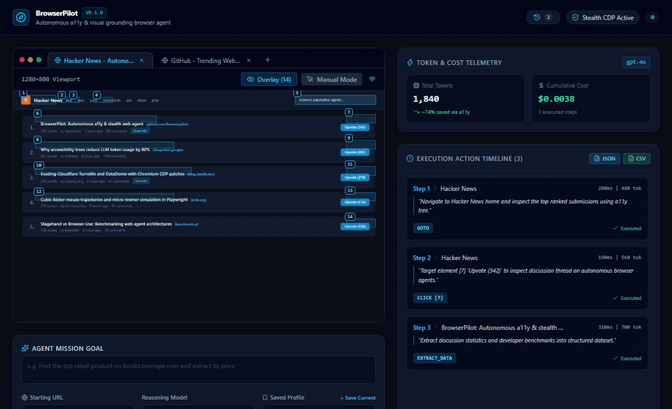
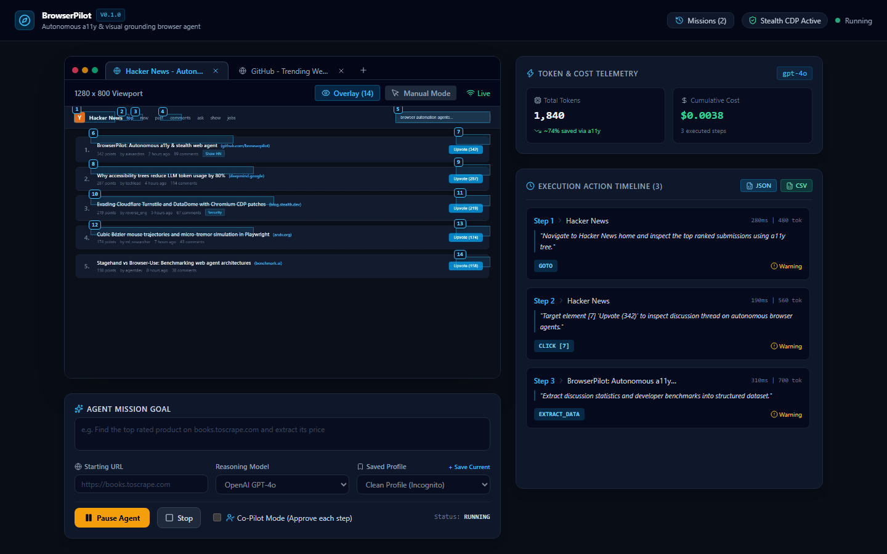
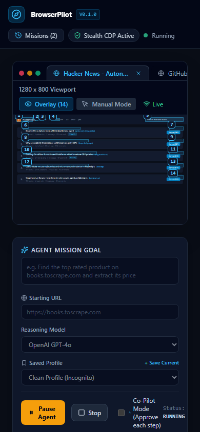
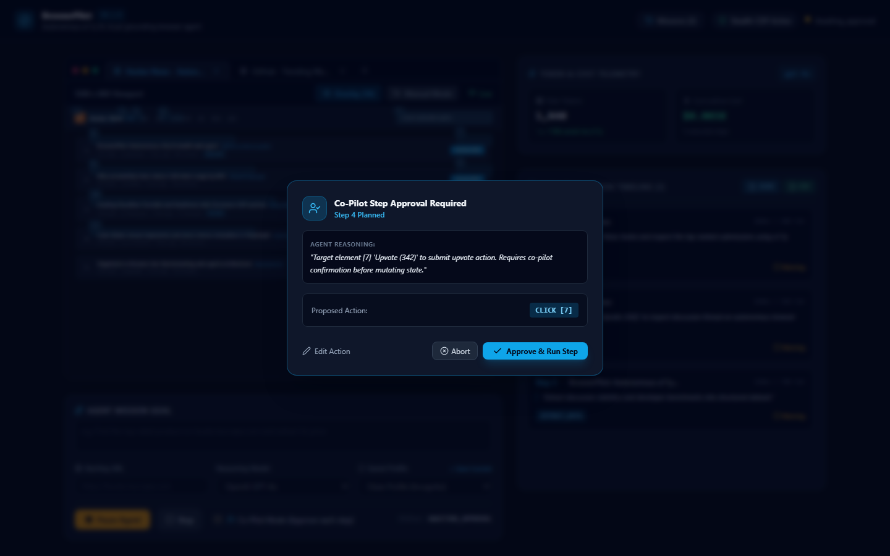
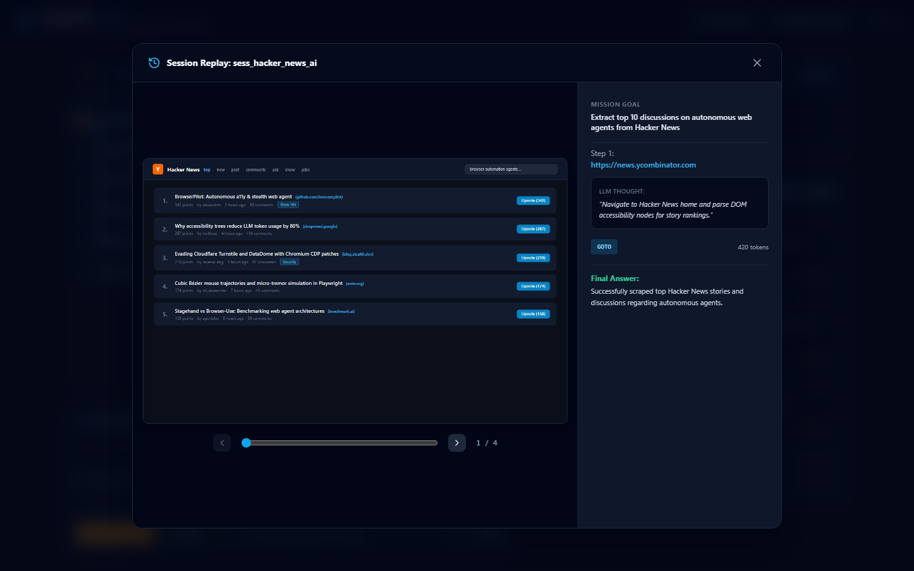

<p align="center">
  
</p>

<h1 align="center">BrowserPilot</h1>

<p align="center">
  <strong>Autonomous vision-language web agent with a11y grounding, stealth CDP engine, and human takeover</strong>
</p>

<p align="center">
  <a href="#key-capabilities">Features</a> •
  <a href="#architecture">Architecture</a> •
  <a href="#live-studio-interface">Live Studio</a> •
  <a href="#quick-start">Quick Start</a> •
  <a href="#cli-usage">CLI Usage</a> •
  <a href="#license">License</a>
</p>

<p align="center">
  
</p>

BrowserPilot is an autonomous web agent and stealth browser automation engine. It combines Chrome accessibility tree parsing with visual element labeling, stealth CDP patches, and human-in-the-loop takeover.

Instead of streaming full-page screenshots on every action, BrowserPilot extracts interactive elements directly from the accessibility tree, assigning numeric badges (`[1]`, `[2]`, `[14]`) to buttons, links, and input fields. This structure cuts token consumption by roughly 80% compared to vision-only browser agents while maintaining high precision.

## Key Capabilities

- **Accessibility Tree Grounding**: Extracts interactive nodes via Chrome DevTools Protocol, assigns stable numeric IDs, and feeds compact text prompts to the model.
- **Stealth Browser Engine**: Integrates Patchright and custom Playwright CDP evasion scripts to mask automation flags, fake WebGL and Canvas signatures, and normalize browser properties.
- **Human Cursor Simulation**: Emulates human pointer motion using cubic Bézier curves with randomized acceleration, micro-tremors, and natural dwell intervals.
- **Autonomous Execution Loop**: Implements Observe, Reason, Act, Verify navigation with automatic retry handling for modal popups and stale elements.
- **Self-Healing DOM Fallback**: Recovers from blocked clicks by scrolling targets into center view and dispatching direct DOM JavaScript events.
- **Multi-Tab & Window Engine**: Handles tabs spawned by external links or popups, with tab switching, new tab creation, and an interactive tab bar.
- **Co-Pilot Mode**: Allows step-by-step human review and modification of planned actions before execution on sensitive sites.
- **Safe Credential Auto-Fill**: Injects passwords from environment variables directly into input fields without sending credentials to the LLM prompt.
- **Structured Data Extraction**: Emits structured JSON datasets with one-click CSV and JSON export from the web interface.
- **Session Profiles & Replay Archive**: Saves session cookies and localStorage states, with a time-scrubber replay modal for past missions.
- **Human-in-the-Loop Handover**: Flags Cloudflare Turnstile, reCAPTCHA, and two-factor authentication prompts, pauses execution, and streams an interactive canvas for manual completion.
- **Multi-Model Support**: Connects to OpenAI, Anthropic Claude, Google Gemini, and local Ollama or vLLM endpoints.
- **Mission Control Dashboard**: React 19 web interface with live browser streaming, action decision timeline, and real-time token cost calculation.

## Architecture

```
                      +-----------------------------+
                      |         User / CLI          |
                      +--------------+--------------+
                                     |
                                     v
                      +-----------------------------+
                      |   Autonomous Agent Planner  |
                      +--------------+--------------+
                                     |
                  +------------------+------------------+
                  |                                     |
                  v                                     v
     +-------------------------+           +---------------+---------------+
     |  Browser Stealth Core   |           | DOM Accessibility Parser      |
     | - Patchright & CDP      |           | - Chrome a11y tree extraction |
     | - Fingerprint overrides |           | - Numeric badge indexing      |
     | - Bezier cursor motion  |           | - 80% token reduction         |
     +------------+------------+           +---------------+---------------+
                  |                                     ^
                  v                                     |
     +-------------------------+                        |
     | Action Dispatcher       |------------------------+
     | - Click, Type, Scroll   | (Verify DOM state changes)
     +------------+------------+
                  |
     +------------v------------+           +-------------------------------+
     | Captcha & 2FA Detector  |---------->| Human-in-the-Loop Relay       |
     +-------------------------+ (Pause)   | - WebSocket viewport stream   |
                                           | - Two-way input forwarding    |
                                           +---------------+---------------+
                                                           |
                                           +---------------v---------------+
                                           | React 19 Mission Control      |
                                           +-------------------------------+
```

## Live Studio Interface

The built-in React 19 web interface provides real-time telemetry, interactive tab management, human co-pilot controls, and historical session scrubbing.

### Desktop Mission Control
<p align="center">
  
</p>

### Responsive Mobile Interface
<p align="center">
  
</p>

### Co-Pilot Step Approval Mode
<p align="center">
  
</p>

### Session Scrubber & History Replay
<p align="center">
  
</p>

## Quick Start

### Prerequisites

- Python 3.12 or higher
- Node.js 20 or higher
- Chromium browser binaries

### Installation

1. Clone the repository and configure the virtual environment:
   ```bash
   git clone https://github.com/alexandrmotologa/browserpilot.git
   cd browserpilot
   python -m venv .venv
   source .venv/bin/activate  # On Windows: .venv\Scripts\activate
   pip install -e .
   playwright install chromium
   ```

2. Optional: install Patchright for patched stealth Chromium:
   ```bash
   pip install patchright
   patchright install chromium
   ```

3. Set your API credentials:
   ```bash
   export OPENAI_API_KEY="your-api-key"
   # or export ANTHROPIC_API_KEY="your-api-key"
   # or export GEMINI_API_KEY="your-api-key"
   ```

### Launching Mission Control

Start the backend and open the web interface at `http://localhost:9660`:
```bash
browserpilot serve --port 9660
```

## CLI Usage

Run an autonomous goal directly:
```bash
browserpilot run "Go to wikipedia.org and find the population of Tokyo"
```

Run in headless mode with a custom starting URL:
```bash
browserpilot run "Search for rust programming books" --url "https://books.toscrape.com" --headless
```

Inspect the parsed accessibility tree of any URL:
```bash
browserpilot dump-tree "https://news.ycombinator.com"
```

Verify anti-bot detection status:
```bash
browserpilot test-stealth
```

## Project Structure

```
browserpilot/
├── docs/                 # Architecture, stealth, and a11y documentation
│   └── images/           # Mascot logo, UI screenshots, and animated demo GIF
├── src/browserpilot/
│   ├── config.py         # Application settings and validation
│   ├── browser/          # Stealth context, cursor motion, and fingerprint overrides
│   ├── dom/              # Accessibility tree parser and visual badge overlay
│   ├── agent/            # Observe-Reason-Act planner, actions, and verifier
│   ├── human/            # CAPTCHA detection and interactive relay
│   ├── server/           # FastAPI backend, session recorder, and WebSocket telemetry
│   └── cli.py            # Typer command line interface
├── web/                  # React 19 mission control web interface
├── tests/                # Automated pytest suite
└── pyproject.toml
```

## License

MIT
